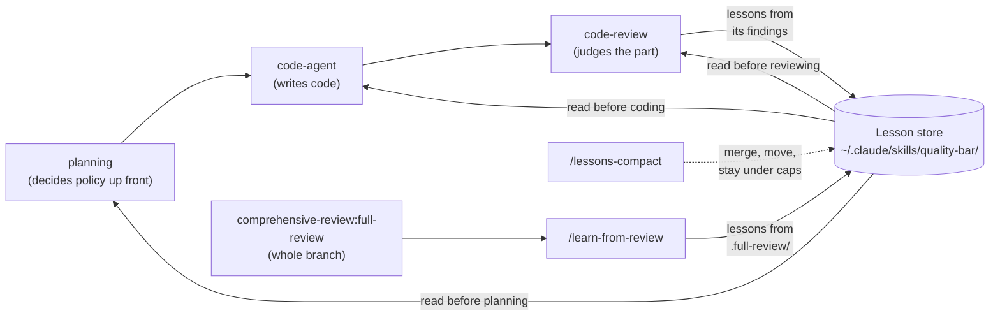
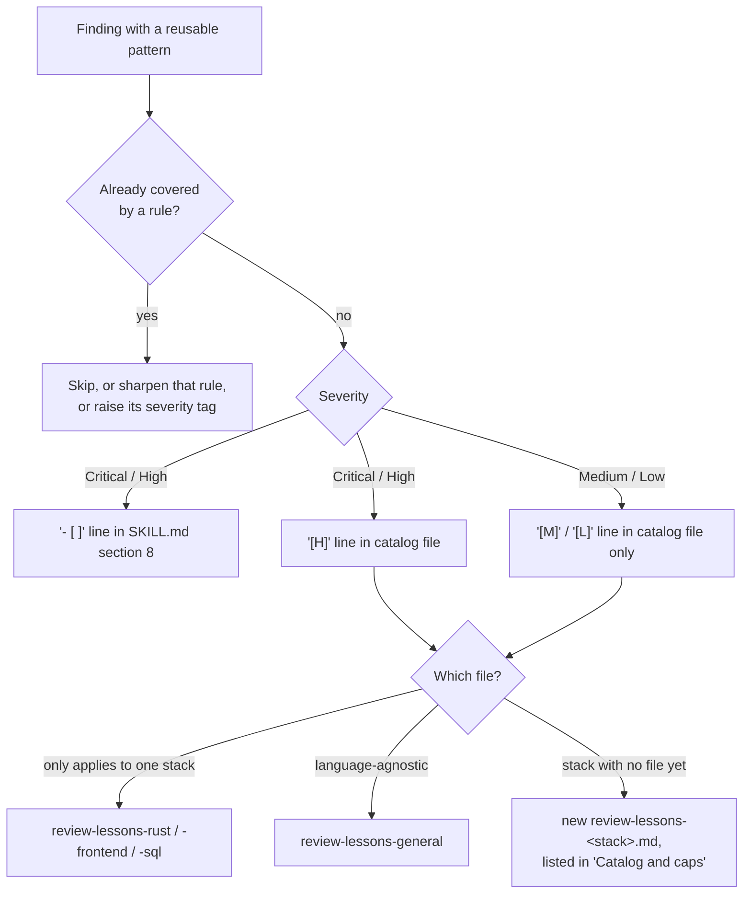
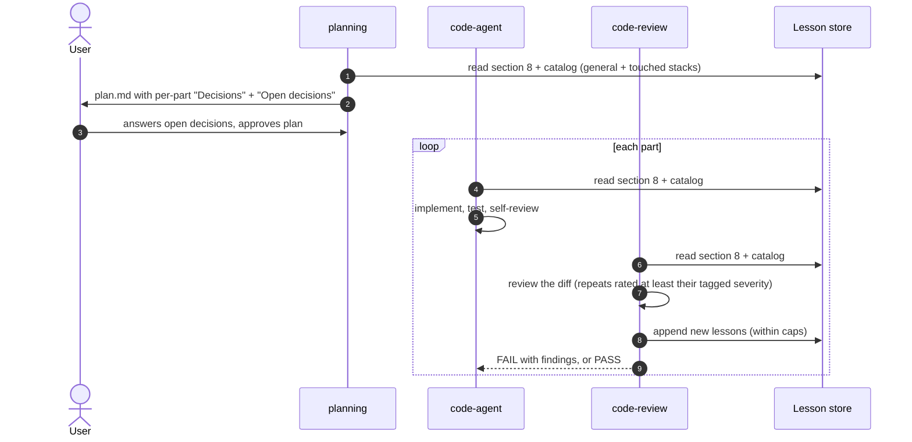
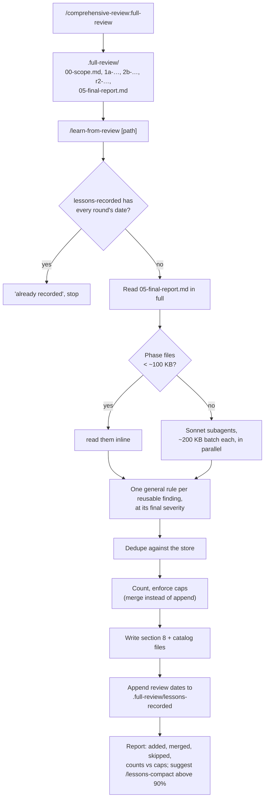
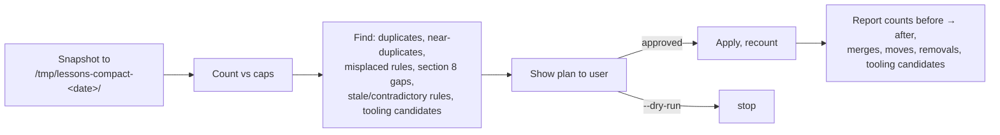

# Learning loop: how reviews make the next change better

Every code review finds issues. The learning loop turns each reusable finding into a short, general rule, stores it in one global place, and feeds it back to the agents that plan, write and review the next change. A mistake found once should not be made again, in any project.

## The idea in one picture



Two review paths feed the store; three agents read from it; one skill keeps it small.

## The lesson store

All lessons live in the `quality-bar` skill directory, so they are global (`~/.claude/`), shared by every project, and never committed to a project repo.

```
~/.claude/skills/quality-bar/
├── SKILL.md                       sections 1-7: the quality standard (never edited by the loop)
│                                  section 8: "Lessons from past reviews"
│                                    - most important rules, as "- [ ]" checklist lines
│                                    - "Catalog and caps": file list and hard caps
├── review-lessons-general.md      full catalog, language-agnostic (read for every change)
├── review-lessons-rust.md         full catalog, Rust backend
├── review-lessons-frontend.md     full catalog, React/TypeScript frontend
└── review-lessons-sql.md          full catalog, SQL, databases and migrations
```

- **Section 8** holds the rules that matter most (High and Critical patterns). It is preloaded into every agent that uses `quality-bar`, so it costs no extra read.
- **The catalog files** hold every lesson, all severities, tagged `[H]`, `[M]` or `[L]` and grouped into numbered `##` sections (external calls, bounds and performance, correctness, tests, …). Agents read `general` plus the file for each stack the change touches.
- Every rule is **general**: an imperative about a pattern, with no project names, file paths, issue numbers or people. Example: "A failed lookup never overwrites or blanks a previously stored value; keep the old value or surface the failure."

### Where a new lesson goes



### Hard caps

| Scope | Cap |
|---|---|
| Section 8 of `SKILL.md` | 60 rules |
| Each `##` section of a catalog file | 30 rules |
| Each catalog file | 150 rules |

Whoever writes a lesson counts first. If the new rule would pass a cap, it is not appended: it is merged into the closest rule, or two or more rules are generalized into one. Low rules are merged first; a High rule is never dropped. When any count passes 90% of its cap, run `/lessons-compact`.

## Path 1: the dev pipeline (`/dev-pipeline`, `/feature`)

The pipeline runs plan → implement → review per part. Lessons are read at every step and written automatically by the reviewer.



What each agent does with the lessons:

| Agent | File | Reads | Writes |
|---|---|---|---|
| `planning` | `claude/agents/planning.md` | section 8 + catalog | `plan.md`: per part, a `Decisions:` sub-list (failure policy, every path changing the same state, delete/cascade behavior, bounds, unverified API assumptions, proving tests); a final `## Open decisions` with recommendations |
| `code-agent` | `claude/agents/code-agent.md` | section 8 + catalog, and `plan.md` decisions | code only |
| `code-review` | `claude/agents/code-review.md` | section 8 + catalog | section 8 of `SKILL.md` and the catalog files, nothing else; reports "Lessons recorded" |

A repeat of a section 8 rule is at least High; a repeat of a catalog rule is at least its tag. High fails the review, so known mistakes are caught inside the pipeline instead of in the full review afterwards.

## Path 2: the comprehensive review (`comprehensive-review:full-review`)

The full review is a third-party plugin and knows nothing about the store. It writes its results to `.full-review/` in the worktree. `/learn-from-review` turns them into lessons; the global `CLAUDE.md` tells the session to run it when a full review finishes, and you can run it yourself at any time.



Files touched by `/learn-from-review`:

| File | Change |
|---|---|
| `~/.claude/skills/quality-bar/SKILL.md` | section 8 only: new or sharpened `- [ ]` lines |
| `~/.claude/skills/quality-bar/review-lessons-*.md` | new, sharpened or merged lines; possibly a new stack file |
| `<worktree>/.full-review/lessons-recorded` | review dates processed, one per line, so a review is never mined twice |

## Keeping the store small: `/lessons-compact`

The store only grows unless something merges it. `/lessons-compact` is that step: run it monthly, when a count passes 90% of its cap, or when `/learn-from-review` suggests it.



- It never loses a High rule's substance, merges Low before Medium before High, and aims to leave every count at or below 90% of its cap.
- Removing a stale or contradictory rule needs the user's explicit yes, per rule.
- **Tooling candidates** are rules a machine could enforce (lint rule, clippy setting, test helper, CI check). It lists them; once you add the check, delete the rule. A failing check beats a text rule.

## Every file in the loop

| File (installed path) | Repo path | Role |
|---|---|---|
| `~/.claude/skills/quality-bar/SKILL.md` | `claude/skills/quality-bar/SKILL.md` | quality standard; section 8 = top lessons, caps |
| `~/.claude/skills/quality-bar/review-lessons-*.md` | `claude/skills/quality-bar/review-lessons-*.md` | full lesson catalog by stack |
| `~/.claude/skills/learn-from-review/SKILL.md` | `claude/skills/learn-from-review/SKILL.md` | full review → lessons |
| `~/.claude/skills/lessons-compact/SKILL.md` | `claude/skills/lessons-compact/SKILL.md` | merge, move, cap |
| `~/.claude/agents/planning.md` | `claude/agents/planning.md` | reads lessons, writes decisions into `plan.md` |
| `~/.claude/agents/code-agent.md` | `claude/agents/code-agent.md` | reads lessons |
| `~/.claude/agents/code-review.md` | `claude/agents/code-review.md` | reads lessons, writes new ones |
| `~/.claude/CLAUDE.md` | `claude/CLAUDE.md` | "Review lessons": run `learn-from-review` after a full review |
| `<worktree>/.full-review/lessons-recorded` | not in repo | per-review marker of processed dates |

## Limits

- **Not enforced by tooling.** Agents follow the rules and the caps because their instructions say so; nothing blocks an agent that skips them. The `CLAUDE.md` trigger after a full review depends on the session noticing the review finished; if no lessons were recorded, run `/learn-from-review` yourself.
- **`code-review` may edit only the lesson files** by instruction; Claude Code cannot restrict `Edit` to one path in an agent definition. A `PreToolUse` hook could enforce it.
- **Lessons do not replace judgment.** They prevent repeats of known patterns. Domain facts (what an external API really returns) and product decisions still need checking and asking; the `planning` agent's "Open decisions" list is where those surface.
- **The store is personal.** It lives in `~/.claude/`; this repo carries a copy so it can be installed elsewhere. Copy changes back here when the live store grows.
